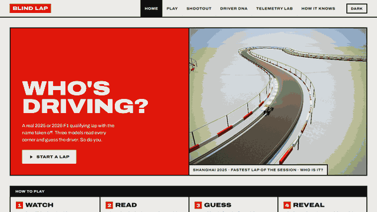
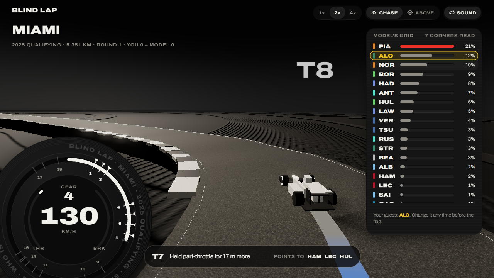
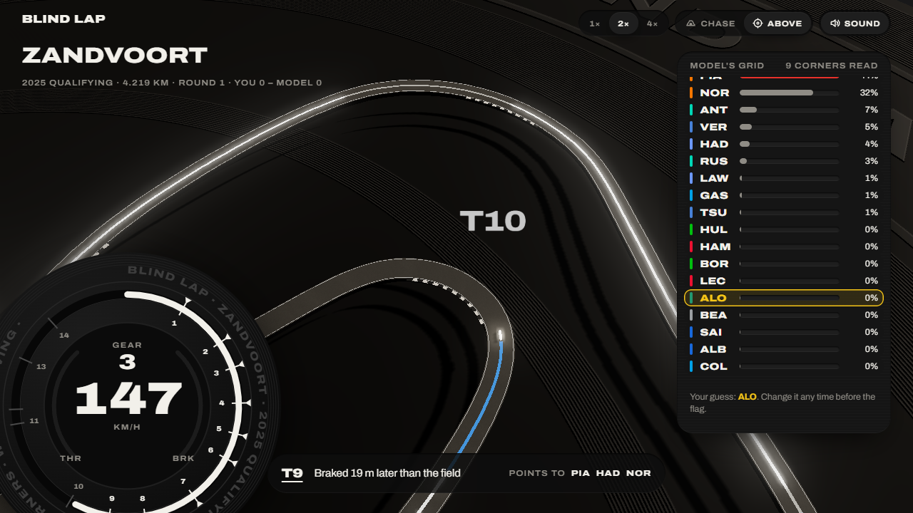
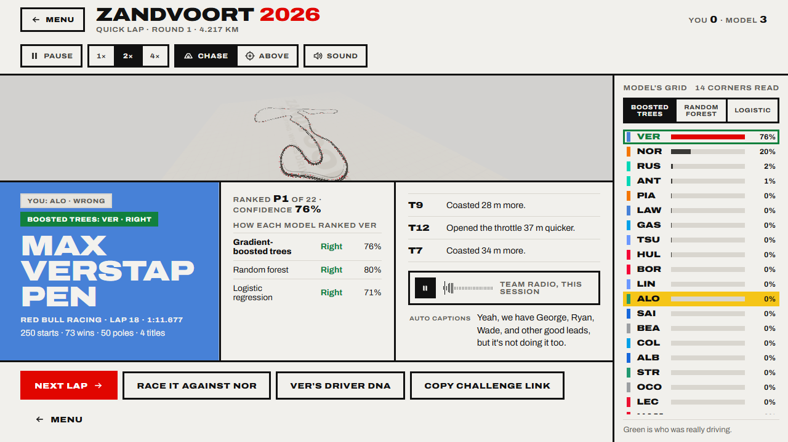
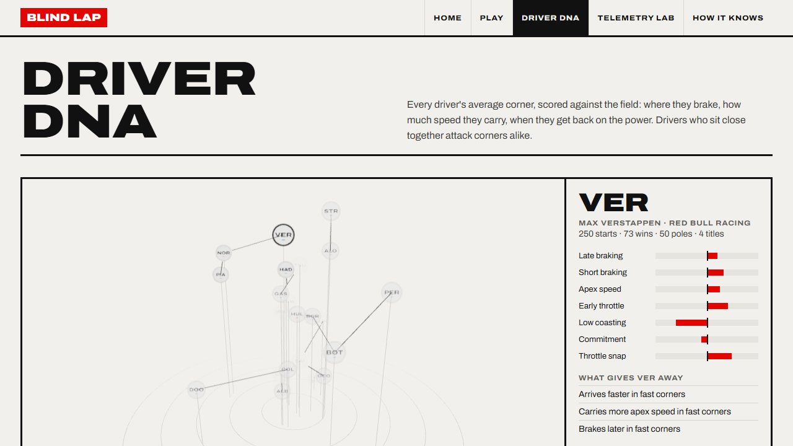

# Blind Lap

**Can a model tell who is driving an F1 car from the telemetry alone?**



Blind Lap replays a real qualifying lap from 2023 to 2026 with the driver's name removed. The lap runs on
a 3D circuit built from the car's recorded position, and you hear an engine synthesised live from its
RPM, gear and throttle. As the car leaves each corner, a model reads how that corner was driven and
updates its guess. You guess too. Then the reveal plays the driver's real team radio from that
session.

- **Play**: one anonymous lap, the model's live line-up, your pick, the reveal. The model says how
  sure it is ("Not sure: GAS, PIA or ALB" to "Very sure: VER") and how often a call that sure was
  right on circuits it never saw. A "More laps" hint and the reveal show its read sharpening as it
  reads the same driver's other laps of the session (43% right from one lap, 66% from six).
- **Teammates**: same car, two drivers: which one is it? You against the model, chance 50%.
- **Which is which**: two real laps from one session run together, you know both names: which car
  is which? The model gets the pair the right way round 95% of the time. Both cars drive one racing
  line, the red car as a see-through ghost, as in a racing game; each lays its own rubber (red where
  it braked) and shows a brake light. "Together at
  each corner" brings them into every braking zone side by side, so you see who brakes first, with
  the distance between them shown live; "As driven" plays both laps exactly as driven. All the cameras of a normal lap, and either car to follow.
- **Duel**: after the reveal, race the lap against the driver the model picked, with a live gap.
- **Challenge link**: send a friend one exact lap, without giving the driver away.
- **Teammate battles**: each season's qualifying head-to-head inside every team, session by session,
  with the median gap between their best laps in the same part of qualifying, and how the two drive
  differently in the same car: seven traits with how many sessions each held in, and the clearest
  single corners ("LEC lifts 17% less than SAI at Lusail Turn 16").
- **Driver DNA**: every driver's corner style with the car taken out. Each corner measurement is split
  into a car part (team and season) and a driver part, fitted over every lap; teammates and drivers
  who changed teams separate the two. A 3D map of own styles (and as driven), each driver season by
  season, every car's fingerprint, and how much of each habit is the car. **Team moves, predicted
  before they happened**: each move (Hamilton to Ferrari, Sainz to Williams and seven more) guessed
  with none of the driver's laps from that season on, as new car + own style, then checked. It beats
  "drives as before" in 7 of 9 and "drives like the new teammate" in 9 of 9. Plus any driver in any
  car, as a labelled guess.
- **Telemetry lab**: any session, any two drivers: speed traces and braking overlaid, the gap along the
  lap, and where the time goes, corner by corner and on the straights.
- **How it knows**: the method and the evaluation, read from the same report the model produced.

| | |
|---|---|
|  |  |
|  |  |

A 45-second recording (a lap at Spa, the reveal and a corner replay) is in
[docs/media/demo.mp4](docs/media/demo.mp4), filmed frame by frame by `web/scripts/record-video.mjs`; 30 seconds of
the synthesised engine on a Singapore lap is in [docs/media/engine.mp3](docs/media/engine.mp3). The full technical
write-up, file by file, is in [docs/OVERVIEW.md](docs/OVERVIEW.md).

## How it works

```
OpenF1 API ──► fetch.py ──► raw/<session>/*.json          (2025 + 2026 qualifying, 2025 practice 3)
MultiViewer ─┘                    │
F1DB release ─► careers.py        ▼
                track.py     one centreline per circuit; every sample projected to metres along it
                features.py  10 style features per corner, z-scored against the field
                build.py     build/<session>.pkl   (corners detected from speed where no map exists)
                                  │
                                  ▼
                model.py     leave-one-circuit-out: boosted trees, random forest, logistic regression
                             (+ cross-season test); per-lap, per-corner scores for all three
                export.py    web/public/data/*.json  (laps, track, fold weights, report, DNA, tells)
                                  │
                                  ▼
web/  Vite + TypeScript + Three.js + Web Audio
      model.ts replays the held-out models' corner scores in the browser, corner by corner
```

Two things on screen are drawn rather than measured, and the game says so: where across the road
the car drives (OpenF1 snaps every car to one line, so each lap reshapes the circuit's racing line
from how it really took each corner), and the engine sound (made live from the real speed, gear and
throttle). Speed, gear, throttle, brake and timing are the car's own.

1. **Data.** Car telemetry (~3.7 Hz), 3D position (~4 Hz) and team radio from
   [OpenF1](https://openf1.org); corner positions from MultiViewer's circuit maps; career totals from
   [F1DB](https://github.com/f1db/f1db). (FastF1's live-timing source returns 401 now, so it is not used.)
2. **One line per circuit.** The fastest lap's positions become a closed centripetal Catmull-Rom
   spline. Every position sample is projected onto it with a KD-tree, so a distance means the same
   place on track for every driver. Laps that go backwards, lose data or disagree with the official
   lap time are dropped.
3. **Corner features.** Each corner zone yields braking point, braking length, entry speed, apex speed,
   apex position, throttle pickup, how sharply and how smoothly the throttle opens, deepest lift and
   coasting distance, each turned into a robust
   z-score against every push lap at that corner in that session: "brakes 9 m later than the field"
   survives a change of circuit.
4. **Models.** Features go into one block per corner type (slow, medium, fast). Three classifiers each
   give P(driver | corner): gradient-boosted trees, a random forest and a multinomial logistic
   regression; a blend averages the three in log space, each on its own fitted temperature. A lap
   sums log-probabilities over its corners with a temperature fitted on held-out laps. Evaluation is
   leave-one-circuit-out across both seasons: the model that guesses at Monza never saw Monza in any
   year. The game offers the blend, the boosted trees and logistic regression (the forest only feeds
   the blend); their per-corner scores are computed offline, so you can switch model mid-lap or after
   the reveal. `compare_models.py` tested more candidates the same way (see docs/OVERVIEW.md).
5. **Front end.** A bold race-poster design: paper, heavy black type, one F1-red block, and the
   3D circuit as a framed picture. On track, red and white barriers and brake boards give a sense of
   speed, and the chase camera pulls back under acceleration and closes in under braking. The car's
   motion integrates the recorded speed, so what you see matches what you hear. The rubber line is
   coloured by the real inputs (red braking, white full throttle). The engine is oscillators at the
   V6 firing frequency through a soft clipper, with turbo whine, wind and exhaust crackle on lifts;
   it cuts out for the team radio, which starts where the speech starts and has auto captions.

## Results

Leave-one-circuit-out over 86 qualifying sessions (2023 to 2026), 7,755 laps, 29 drivers; 63
practice 3 sessions add training laps only. Each corner also gives the models its shape (the field's
apex and entry speed, whether it brakes there) and the previous corner, both already known when the
corner is read. Read live from `pipeline/model_out/report.json` and shown on the How it knows page.

| Model | Top-1 driver | Top-3 driver | Right team | Right teammate |
|---|---|---|---|---|
| Chance | 3.4% | 10.3% | about 9% | 50% |
| Blend of the three below (trees x2, forest x1, logistic x0.5) | **45.4%** | **72.6%** | **62.3%** | **74.0%** |
| Gradient-boosted trees | 44.2% | 71.3% | 63.1% | 73.9% |
| Random forest (in the blend only) | 41.4% | 67.8% | 57.7% | 68.3% |
| Logistic regression | 31.7% | 59.9% | 51.4% | 71.2% |
| Cross-season (logistic): trained on 2023-2025, tested on 2026 laps | 23.7% | 51.3% | 38.0% | |

- The blend is right about 10 times as often as picking at random, on circuits it never saw.
- **Style survives new cars.** Trained only on 2025, it still names the driver of a 2026 lap 26% of the
  time against 5% chance, under new regulations and, for some drivers, a new team.
- **It is not just recognising the car.** Given the car, the models pick the right one of the two
  teammates on 71 to 75% of laps (chance 50%). Two drivers, same car, same
  session: what is left is how they drive. The confusion matrix still shows the model often finds the
  car before the driver, and the easiest drivers to spot include those in the most unusual cars.
- The trees win because driving style is not additive: braking late matters more in a slow corner
  than in a fast one, and trees find those interactions alone. The linear model stays in the game
  because each corner's push toward a driver is a readable sum. Adding 18 practice sessions as
  training data left it flat while the tree model gained a point; two throttle features (how sharply
  and how smoothly the driver opens up) added 2.7 points. The linear model was limited by its
  features, not by data.

## Run it

```bash
# data + model (Python 3.12, uv)
cd pipeline
uv venv --python 3.12 .venv
uv pip install --python .venv/Scripts/python.exe -r requirements.txt
.venv/Scripts/python.exe fetch.py                                   # 2025 qualifying
BLINDLAP_YEAR=2026 .venv/Scripts/python.exe fetch.py                # 2026 qualifying so far
BLINDLAP_SESSION="Practice 3" .venv/Scripts/python.exe fetch.py     # extra training laps
./run_all.sh                     # build, train, evaluate, export, then check.py validates the output

# web
cd ../web
npm install
npm run dev        # http://localhost:5173
npm run build      # static site in web/dist, deployable to any static host
```

To publish, push to a GitHub repository with Pages set to "GitHub Actions": `.github/workflows/pages.yml`
builds `web/` and deploys it. The site uses relative paths and hash routes, so it works on a sub-path.

OpenF1 allows about 30 requests a minute, so each season takes about an hour to download. The
exported data is committed, so the web app runs without the pipeline.

## Tests

```bash
cd web
npm run typecheck
npx playwright test   # plays a full round in headless Chromium with WebGL, plus duel, DNA, lab, How, challenge links, cameras, seeking
```

## Credits

Telemetry, positions and team radio: OpenF1. Corner maps: MultiViewer. Career totals: F1DB.

Surroundings (buildings, grandstands, water, woods, trees, Ferris wheels): map data ©
[OpenStreetMap contributors](https://www.openstreetmap.org/copyright), under the ODbL. The derived
files in `web/public/data/env/` are under the same licence (see the LICENSE.txt there).

Car model: this work is based on ["( FREE ) Formula One LP-830 SDC"](https://sketchfab.com/3d-models/free-formula-one-lp-830-sdc-aeebdfa53e294e0390f3c2e8bbfe31b6)
by [SDC PERFORMANCE](https://sketchfab.com/3Duae), licensed under
[CC BY 4.0](http://creativecommons.org/licenses/by/4.0/). Changes: textures removed, materials flattened
and repainted in the game (`web/scripts/prep-car.mjs`). Licence text: `web/public/models/lp830/LICENSE.txt`.

Blind
Lap is a fan project and is not associated with Formula 1, the FIA or any team.
