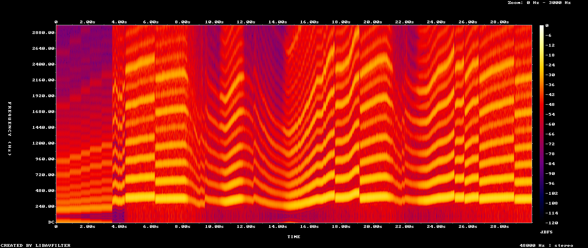

# Blind Lap: full overview

This document explains what was built overnight on 2026-10-23, how each part works, and why it was
built that way. It is written for the owner, for a reviewer reading the repository, and for anyone
who wants to extend it.

## 1. The idea in one paragraph

Every F1 driver attacks a corner a little differently: one brakes later, one carries more speed to
the apex, one gets back on the throttle earlier. Blind Lap asks whether that "handwriting" is strong
enough to identify a driver from telemetry alone. It replays a real 2025 or 2026 qualifying lap with
the name removed, on a 3D circuit built from the car's own position data, with an engine sound
synthesised from the car's own RPM and throttle. As the car leaves each corner, a model trained on
other circuits reads that corner and updates its guess. The player guesses too. The reveal plays
the driver's real team radio.

## 2. What exists now

| Surface | What it does |
|---|---|
| Home | A hub. A red block with "Who's driving?" and "Start a lap", a framed 3D view orbiting a random circuit with its fastest lap, three mode tiles (Quick lap, Teammates, Pick a circuit) and the best model's real held-out accuracy next to chance. A top bar on every page links all of them. |
| Play | Start lights, then an anonymous lap in a framed chase camera (or overhead). A "Menu" button top-left always leads back; Escape does too. Under the view, a telemetry band: speed, gear, throttle and brake meters, a lap rule with a tick per corner. The model's grid of drivers re-sorts after every corner, and a switch picks which of the three models it shows. An evidence line says what the corner showed ("braked 11 m later than the field") and which drivers it pointed to. 3D captions appear beside the corners the model read. Click a driver to guess. 1x, 2x, 4x playback. Space pauses, C switches camera. |
| Reveal | The band under the view floods with the driver's team colour and the car takes the team livery colour. Verdicts for you and the model (right, teammate, wrong), driver, team, lap time, career totals from F1DB; how each of the three models ranked the real driver; the three corners that pointed hardest at them; and the real team radio clip from that session, starting where the speech starts, with auto captions. |
| Teammates | `#/mates`: the HUD names the team ("Which McLaren driver?"), the grid holds only its two drivers, and you and the model guess. It is the teammate test from section 4.6 as a game. |
| Duel | Replays the lap against the fastest lap of the driver the model picked (or its runner-up when it was right), as a red ghost car, with a live time gap at the white car's position. |
| Challenge link | "Copy challenge link" on the reveal gives a URL (`#/play/<session>.<lap index>`) that opens that exact lap for a friend. The link uses the lap's position in the session file, so it does not reveal the driver. |
| Driver DNA | Every driver's average corner style as a 3D point (PCA of 30 style dimensions). Drag to turn, click or pick a driver to see seven plain-language style traits, the three habits that give them away, closest matches and career totals. |
| Telemetry lab | Any session, any two drivers: their fastest laps' speed traces overlaid against distance, braking as marks under the trace, and for each corner the single biggest difference between them in words ("VER brakes 15 m earlier than LEC"). |
| How it knows | The method and the honest numbers: top-1, top-3 and team accuracy as bars against chance, the cross-season result, accuracy per session, the easiest and hardest drivers to spot, a confusion matrix, what the data cannot see, and the GBM comparison. All read from the evaluation report. |

## 3. Architecture

```
                     ┌──────────────────────────── pipeline/ (Python) ───────────────────────────┐
OpenF1 REST ────────►│ fetch.py      raw JSON per session: drivers, laps, car_data, location,      │
MultiViewer API ────►│               team_radio, weather, circuit corners                          │
F1DB release zip ───►│ careers.py    career totals per driver                                      │
                     │ track.py      centreline per circuit, lap alignment to metres               │
                     │ features.py   8 corner features, z-scored against the field                │
                     │ build.py      build/<session>.pkl                                           │
                     │ model.py      leave-one-circuit-out evaluation + per-session fold weights   │
                     │ export.py     web/public/data/{index,report,dna}.json, sessions/<key>.json   │
                     └───────────────────────────────────────┬─────────────────────────────────────┘
                                                             │ static JSON (committed)
                     ┌───────────────────────────── web/ (TypeScript) ─────────────────────────────┐
                     │ data.ts   types + cached loaders       model.ts  in-browser inference         │
                     │ lap.ts    telemetry interpolation      audio/engine.ts  Web Audio V6 synth    │
                     │ scene/world.ts  Three.js track, car, ghost, rubber-line shader, cameras       │
                     │ scene/textures.ts  asphalt grain, sidewall relief, corner caption sprites     │
                     │ ui/play.ts  round state machine   ui/lineup.ts  ui/telemetry.ts               │
                     │ ui/stage.ts  one canvas docked per page   ui/dna.ts  ui/how.ts  ui/lab.ts     │
                     │ main.ts  hash router, home hub, render loop                                   │
                     └──────────────────────────────────────────────────────────────────────────────┘
```

The split is deliberate. All heavy work (download, alignment, training, evaluation) happens once,
offline, in Python. The browser gets small static JSON and does only what must be live: rendering,
audio and running a linear model over a handful of numbers per corner. The site therefore hosts on
any static host with no server.

## 4. The data pipeline in depth

### 4.1 Sources and why

- **OpenF1** (`api.openf1.org/v1`): free, no key, JSON. Gives `car_data` (speed, throttle, brake,
  gear, RPM, DRS at about 3.7 Hz), `location` (x, y, z at about 4 Hz), `laps` (start time and
  duration of every lap), `drivers` and `team_radio` (MP3 URLs). Rate limit is about 30 requests a
  minute, so `fetch.py` paces itself and backs off on 429 and 5xx. A full season of qualifying
  (24 sessions × ~45 requests) takes about an hour.
- **FastF1** was the first plan. Its live-timing source (`livetiming.formula1.com/static`) returned
  HTTP 401 for session data during this build, so it was dropped. Team radio MP3s on the same host
  still return 200, so the game can play them.
- **MultiViewer** (`api.multiviewer.app/api/v1/circuits/<key>/<year>`): corner numbers and their
  positions in the same coordinate frame as OpenF1's location data, plus the broadcast map rotation.
- **Kaggle's "F1 World Championship 1950–2024"** is the most popular F1 dataset, but it is an
  Ergast dump with results and lap times only. It has no telemetry, so it cannot power this.
- **F1DB** (GitHub release `v2026.17.0`, checksum verified): career totals (starts, wins, poles,
  podiums, titles). Used for the reveal card and the DNA panel.

Downloaded: every 2025 qualifying session (24), every 2026 qualifying session held so far (17, up to
Singapore on 10 October 2026), and every 2025 Practice 3 (18; sprint weekends have none). About 6 GB
of raw JSON, kept out of git.

### 4.2 Turning samples into comparable laps (`track.py`)

OpenF1 gives no lap distance, and telemetry and position arrive on different clocks. Comparing
"where did they brake" needs every sample placed on the same measuring tape.

1. **Push laps**: timed laps that are not out-laps, within 2.5% of the driver's own best lap and
   inside the 107% rule. A first version used "within 3.5% of the session's best", which silently
   dropped every lap of the slowest team (Cadillac in 2026); judging each driver against their own
   best keeps the whole grid.
2. **Centreline**: the fastest lap with clean position data is turned into a closed loop.
   Near-duplicate points are dropped, a centripetal Catmull-Rom spline is run through the rest
   (centripetal parametrisation avoids loops and overshoot at tight corners), the curve is resampled
   every metre and lightly smoothed with a circular moving average. The start is rotated so s = 0
   sits at the timing line.
3. **Projection**: a KD-tree over the 1 m centreline points (3D, so Suzuka's crossover does not
   confuse the two levels) maps every position sample to a distance s. Distances are unwrapped
   across the line, anchored so the sample nearest the official lap start is near 0, and made
   monotonic.
4. **Validation**: the lap's start and end are recomputed as the times s crosses 0 and the lap
   length. A lap is dropped when that disagrees with the official start by more than 3 s, with the
   official duration by more than 1 s, or when s goes backwards by more than 60 m (spin or bad data).
5. **Telemetry onto distance**: each telemetry timestamp gets its s by interpolating the position
   track in time.

Result on Melbourne: 90 of 90 push laps aligned; centreline 5,243 m against an official 5,278 m (the
spline cuts the inside of corners slightly, which does not matter because every lap uses the same
tape).

### 4.3 Corner features (`features.py`)

Each corner gets a zone from halfway after the previous corner to halfway before the next (at most
450 m before and 300 m after the apex marker). Inside the zone:

| Feature | How it is measured |
|---|---|
| brake_point | first off-to-on brake transition before the apex, midpoint between samples, relative to the marker |
| brake_length | metres from brake on to the last braking sample before the apex |
| entry_speed | speed when braking starts (or peak speed before the apex if there is no braking) |
| apex_speed | minimum of speed interpolated on a 2 m grid within ±120 m of the marker |
| apex_offset | where that minimum happens relative to the marker |
| throttle_point | metres after the apex until throttle first reaches 95% |
| min_throttle | deepest throttle in the zone (lift depth on corners taken without braking) |
| coast | metres with throttle under 5% and no brake before the apex |
| throttle_ramp | metres from the first throttle (over 20%) after the apex to full throttle: how sharply the driver opens up |
| partial_throttle | metres between 20% and 95% throttle in the zone: how much the driver modulates |

The last two were added late in the night after an ablation: together they raised top-1 accuracy by
about 3 points. Gear at the apex was tried in the same experiment and added about 4 more points, but
it also raised team accuracy by as much, which says it mostly identifies the car's gearing. It was
left out, because the product's claim is "style, not car".

Then every value becomes a **robust z-score** against every push lap at that corner in that session:
(value − median) / max(1.4826 × MAD, noise floor). The floors (6 m for distances, 2 km/h for speeds,
3% for throttle) stop a corner where everybody does the same thing from turning noise into huge
scores. Brake features are switched off at corners where most of the field does not brake. Missing
values become 0, which means "like the field". Scores are clipped to ±4.

Why z-scores: "brakes at 112 m" means nothing at another circuit; "brakes 0.8 standard deviations
later than the field" carries over. It also removes most of the session-wide effects (track
evolution, wind) that hit everyone.

Each corner is also classed slow (field apex speed under 140 km/h), medium (under 220) or fast. The
10 features are placed into one of three blocks of a 30-dimensional vector, so the model can learn
that a driver brakes late for hairpins but lifts early in sweepers.

### 4.4 The model (`model.py`)

- **Samples**: one row per (lap, corner). Label: the driver's three-letter code. Drivers with fewer
  than 4 sessions are left out of the label set.
- **Classifier**: multinomial logistic regression, `C = 0.1`, balanced class weights (Q3 drivers
  have more laps than Q1 drivers). C was chosen by a sweep (0.01 to 1.0); 0.1 to 1.0 were within
  half a point of each other.
- **Lap guess**: the sum over corners of log P(driver | corner), divided by a temperature. Summing is
  naive Bayes over corners. Corners of one lap are not independent witnesses, so the raw sum is
  overconfident; the temperature that minimises held-out log loss is fitted from the evaluation.
- **Evaluation**: leave-one-circuit-out. For each circuit, a model is trained on every session at
  every other circuit (both seasons) and scores that circuit's laps in every year. This is the only
  honest test for this question: the same circuit in training, even from the other season, would let
  the model memorise "who was fast at Monza", not driving style. With one season this is the same as
  leave-one-session-out; with two it is stricter.
- **Cross-season test**: a model trained only on 2025 guesses every 2026 lap of drivers who raced
  both years. 2026 brought new cars and new rules, so this asks whether style survives a new car.
- **Baselines tried**: a histogram gradient-boosted tree model scored a few points higher top-1; a
  small MLP (32 or 64 hidden units) scored lower. Logistic regression ships because each corner's
  push toward a driver is a readable sum of weight × feature, and the weights are a few KB.
- **Outputs**: `model_out/report.json` (top-1, top-3, team accuracy, per-circuit accuracy, confusion
  matrix, temperature) and one set of fold weights per session.

### 4.5 Export (`export.py`) and careers (`careers.py`)

Per session: the centreline every 4 m, corners with zones and classes, the field's medians and
scales, driver names and team colours, the fold weights for that session (trained without it), and
the two fastest laps per driver with time, distance, speed, throttle, brake, gear, RPM, DRS, the
corner z-scores and the raw corner values (for sentences like "11 m later"), plus the team radio
clip nearest after the lap. The DNA file averages each driver's 30-dimensional vector over every lap
of the season, runs PCA to 3D, finds each driver's three closest matches by cosine similarity, and
computes seven plain-language traits scaled so the most extreme driver reaches ±1.

### 4.6 Final numbers

Leave-one-circuit-out on 40 qualifying sessions (23 from 2025, 17 from 2026), 3,669 laps, 24 drivers.
18 practice 3 sessions from 2025 are used as extra training laps only.

| Model | Top-1 driver | Top-3 driver | Right team | Log loss |
|---|---|---|---|---|
| Chance | 4.2% | 12.6% | about 9% | 3.18 |
| Logistic regression (ships) | **34.7%** | **64.2%** | **49.1%** | 2.08 |
| Gradient-boosted trees | 42.9% | 72.6% | 58.7% | 1.75 |
| Cross-season (train 2025, test 2026) | 25.4% | 55.6% | 40.3% | |

**Teammate test.** For every lap, keep only the two drivers of the right team and ask the model which
one it was. Same car, same session, so the car cannot help. Logistic regression is right on **71.4%**
of 3,669 laps and the tree model on 73.5%, against 50% chance. This is the cleanest evidence in the
project that the model reads the driver and not only the car.

How the number moved during the night, and why:

| Setup | Top-1 (logistic) |
|---|---|
| 4 sessions of 2025, leave-one-session-out | 30.4% |
| 23 sessions of 2025 | 37.3% |
| + 16 sessions of 2026, leave-one-circuit-out, fair lap filter, 24 drivers | 31.9% |
| + 18 practice sessions as training data | 31.7% |
| + throttle ramp and partial-throttle features | 34.4% |
| + stricter lap validation (official and measured lap time within 1 s) | 34.7% |

The drop from 37% to 32% is the test getting harder, not the model getting worse: more drivers
(24 instead of 21), a stricter holdout (the same circuit's other season is also held out), two very
different generations of car, and the slower teams back in the data.

Per session, Hungaroring is easiest (52% in 2026, 49% in 2025) and Melbourne 2026 hardest (13%, the
first qualifying under the new rules; why it is so low was not investigated). Per driver, the easiest to
spot include drivers in the most unusual cars (Pérez and Bottas at Cadillac), which is the car-vs-driver
caveat again; the hardest are midfield drivers whose cars and styles sit near the field average.

**Data gaps.** OpenF1 has no lap timing for Baku 2025 qualifying, so it is not in the game. MultiViewer
has no corner map yet for Madring (Madrid) and Kuala Lumpur 2026, so their corners are detected from
the fastest lap's speed trace (7 braking corners each). Las Vegas 2025 qualifying was wet.

## 5. The web app in depth

### 5.1 Stack

Vite 6, TypeScript 5.8 (strict, no unused locals), Three.js 0.170, Web Audio, no UI framework. One
self-hosted variable font, Archivo, with a width axis: expanded black for names and numbers,
normal width for sentences. Playwright for end-to-end tests.

### 5.2 Rendering (`scene/world.ts`, `scene/textures.ts`)

- **Track**: a ribbon 13 m wide following the real x, y, z (elevation exaggerated 2× so hills read),
  rotated to the broadcast map orientation. It is a 3 m thick strip floating 10 m over the ground, so
  its shadow draws the circuit's shape on the sidewall below. (A first version dropped solid walls to
  the ground; on hilly tracks like Austin they became black cliffs.) Asphalt is a generated grain texture tiled every 14 m. Painted edge lines. Striped
  kerbs on the inside of every corner (inside found from the sign of the tangent's turn).
- **Ground**: a paper plane printed like a poster: a fine grid and the circuit name and year in huge
  letters, so the track sits on the page it belongs to.
- **Barriers and brake boards**: red and white barrier blocks every 6 m along both edges, and 150,
  100 and 50 m boards before every real braking zone. Objects passing at the side are what make
  speed readable; without them the lap looked like a constant speed.
- **Rubber line**: a narrow strip on the racing line with per-vertex colour from the real inputs:
  red under braking, paper white at full throttle, grey otherwise. A custom shader hides what the
  car has not reached, fades what is behind it like a wake, and keeps corners at full strength once
  the model has read them (a per-vertex `aKeep` attribute). At the reveal the whole line lights.
- **Car**: a stylised low-poly F1 car built from primitives (`scene/car.ts`): floor, tub, nose,
  sidepods, engine cover, airbox, halo, front and rear wings, and four wheels with a painted sidewall
  band that spin by the real distance travelled. It is ink during the lap (the livery would give the
  team away) and takes the team colour at the reveal; in the duel both cars are in team colours.
- **Corner pulses**: when the model reads a corner, a ring of light spreads across the track from it.
- **Cameras**: chase (16 m behind plus a little per km/h, 5 m up; it pulls back under acceleration
  and closes in under braking, and the field of view widens with speed), overhead,
  and an orbit for title and reveal. On-board cameras smooth their offset from the car
  rather than their absolute position, so they never fall behind at 4× playback.
- **Post**: ACES tone mapping, a restrained bloom pass for the car and the line, 4096 shadow map.
- **Sky and fog**: a dome shader with a low neutral haze, a touch brighter on the side the light
  comes from. Fog uses the same colour in linear space so ground and sky meet without a seam, and
  its distance changes per camera: close on board, so the far side of the circuit melts away; far
  overhead and in the overview, so the whole sidewall stays visible.
- **One canvas, many frames**: there is one WebGL canvas. Each page that shows 3D has a frame with a
  slot, and `ui/stage.ts` moves the canvas into it; a ResizeObserver keeps the renderer at the
  frame's size. Pages without 3D park the canvas off screen.
- **Corner labels**: sprites with corner numbers; on board only the next few corners show. Once
  read, a label turns soft red and gains a caption of what the model saw ("BRAKES 11 M LATER").

### 5.3 Engine sound (`audio/engine.ts`)

A 1.6 L V6 four-stroke fires three times per crank revolution, so the fundamental is RPM / 60 × 3
(about 600 Hz at 12,000 RPM). Four oscillators (crank order sub, fundamental, square and triangle
harmonics) are mixed, soft-clipped by a tanh wave shaper, and sent through a resonant low-pass whose
cutoff opens with throttle and RPM. On top: a sine for the turbo and MGU-H whine, filtered noise for
wind and tyre roar that grows with the square of speed, a short gain dip on upshifts and bursts of
band-passed noise for exhaust crackle when the driver lifts sharply or downshifts.



The spectrogram above is 30 seconds recorded from the app in headless Chromium
([engine.mp3](media/engine.mp3)): the first 3.6 s are the revs rising with each start light, then
each saw-tooth climb in the harmonic stack is one gear's RPM rising, cut off by an upshift, and the
long dips are the braking zones. Mean level is -20 dB with peaks at -7 dB, so nothing clips.

Browsers start audio only after a user gesture. Starting a round from the title is one; opening a
challenge link directly is not, so the engine resumes on the first tap or key press.

Pitch comes from speed × a per-gear ratio learnt from the lap itself (median RPM/speed in each
gear), not from the 3.7 Hz RPM channel directly. Interpolating RPM would smear every gear change
over a quarter of a second; computing it from the held gear makes each shift instant.

### 5.4 The model in the browser (`model.ts`)

For each corner: build the 30-dimensional vector from the lap's stored z-scores, compute logits with
the session's fold weights, log-softmax over every class the model knows, keep the drivers in this
session, add to a running log-probability per driver. The display divides by the temperature and
normalises. Each step also yields: the drivers this corner pushed up most (relative to the average
driver), and a sentence from the corner's most unusual feature using the raw value minus the field
median ("went to full throttle 14 m earlier"). The reveal's caption lists the three corners that
pointed hardest at the real driver.

### 5.5 Game flow (`ui/play.ts`)

A small state machine: loading → lights (five lights, 0.7 s apart, then a random 0.4–1.3 s hold,
like a real start) → lap → reveal ↔ duel. Laps are sampled with a cursor-based interpolator
(`lap.ts`). Corners are read when the car passes the end of their zone. Scoring: 3 for the right
driver, 1 for their teammate, 0 otherwise, for both you and the model; kept in localStorage. Speed
preference is kept too. Storage is always wrapped in try/catch so a private window still plays.

### 5.6 Design

The visual direction was set with the impeccable design skill and recorded in
`.impeccable/surfaces/web-index-html.md`. The first world was a tyre (matte black rubber, moulded
lettering, compound colours). In the morning the owner found it bland and the navigation confusing,
and chose "C, bold poster" from three mockups. The shipped world is a race poster you can play:
light paper, heavy wide black type, F1 red as the one brand block and the primary action, yellow for
your own pick, green for correct, and team colour only where a named driver owns it (the reveal
field, chips, the car after the reveal). Sharp corners, 3px rules, no shadows. The 3D view is a
framed picture on the poster. Every page has a top bar; a lap has a Menu button. DESIGN.md records
the system.

### 5.7 Design review

The finished build went through the impeccable finish reviewer, a fresh subagent that judges the
screenshots and code against the written direction contract. Round one returned "fix" with eight
groups of material problems. All of them were real, among them: rows overprinting while the grid
re-sorted; yellow (your pick) used for a model verdict; team colour used as a big stripe; corner
sprites printing over the title copy; the phone duel bar running off screen; a "hero metric" scoreboard.
Round two scored two groups resolved and six partial, and found three regressions from round one (a
warm haze outside the palette, the ground lost in the overhead view, amber percentages). A final batch
addressed those, verified with fresh captures rather than a third review round. The open items are
listed in section 8. DESIGN.md records the shipped system.

After the car, Lab and Teammates mode were added, a third, fresh review of the whole build (all 16
captures) returned "fix" again with eight items. Persistence, type, material, ground and the play
first viewport matched. The fixes: soft red was still on the primary button, so it became ink; a
stronger scrim behind the title copy; the duel camera now frames both cars and sits left of the grid;
the car body became one extruded side profile instead of stacked boxes; phone Teammates and Lab
layouts; and an explicit "no team radio" state. All eight were addressed and checked with fresh
captures; they were not re-scored by the reviewer.

## 6. File by file

| File | Purpose |
|---|---|
| `pipeline/fetch.py` | Paced, resumable downloader for OpenF1 and MultiViewer. Skips files already on disk. |
| `pipeline/track.py` | Loading raw JSON, centreline building (Catmull-Rom), KD-tree projection, lap alignment and validation. |
| `pipeline/features.py` | Corner zones, the 8 corner features, robust field z-scores, corner classes, block expansion. |
| `pipeline/build.py` | Runs track + features for each session, writes `build/<key>.pkl`. One bad session never stops the rest. |
| `pipeline/model.py` | Leave-one-circuit-out training and evaluation for logistic regression and GBM, the 2025 to 2026 cross-season test, temperature fitting, report and fold weights. |
| `pipeline/export.py` | Writes the web data: sessions, index, report, DNA (PCA, neighbours, traits). |
| `pipeline/careers.py` | Matches game drivers to F1DB by name and writes career totals. |
| `pipeline/run_all.sh` | Build, train, export, careers and checks for every fully downloaded session. |
| `pipeline/check.py` | Invariants on the exported data: laps move forward, corners in order, weight shapes match, no impossible values, model beats chance. It caught one lap whose position track and official time disagreed by 3 s, which led to tighter lap validation. |
| `web/src/main.ts` | Hash router (home, play, mates, DNA, lab, how), the home hub, the phone menu and the single render loop. |
| `web/src/data.ts` | Types for every JSON file, cached loaders, career line formatting. |
| `web/src/lap.ts` | Smooth lap motion (integrated speed with a drift correction to the recorded positions), telemetry at any time, lap time formatting. |
| `web/src/model.ts` | Replays the three models' per-corner scores, evidence sentences and captions. |
| `web/src/audio/engine.ts` | The engine synthesiser and per-gear ratio estimation. |
| `web/src/scene/world.ts` | Three.js scene: track, ground, kerbs, rubber-line shader, car, ghost car, labels, cameras, post-processing. |
| `web/src/scene/car.ts` | The low-poly F1 car and its spinning wheels. |
| `web/src/scene/textures.ts` | Generated textures: asphalt, the printed poster ground, brake boards, corner labels with captions. |
| `web/src/ui/play.ts` | Round state machine, HUD, reveal, team radio, duel, seeking, cameras. |
| `web/src/ui/lineup.ts` | The model's grid: rows that re-sort with transforms, your pick, the truth. |
| `web/src/ui/telemetry.ts` | The telemetry band: speed, gear, pedal meters, lap rule with corner ticks. |
| `web/src/ui/stage.ts` | Docks the one WebGL canvas into the current page's frame. |
| `web/src/ui/dna.ts` | The DNA 3D view and trait panel. |
| `web/src/ui/how.ts` | The method page: bars against chance, cross-season result, per-session and per-driver accuracy, confusion matrix canvas. |
| `web/src/ui/lab.ts` | The telemetry lab: SVG speed traces, braking marks, per-corner differences. |
| `web/scripts/capture.mjs` | Captures every surface at desktop and phone size for design review. |
| `web/scripts/record-demo.mjs` | Records the demo video and README screenshots in headless Chromium. |
| `web/scripts/record-engine.mjs` | Records 30 s of the synthesised engine during a real lap (dev server). |
| `DESIGN.md`, `.impeccable/design.json` | The shipped design system: tokens, rules, components, motion. |
| `web/src/ui/icons.ts` | A small authored SVG icon set. |
| `web/src/styles.css` | Poster tokens (paper, ink, red), type, top bar, home hub, play grid, reveal band, pages, phone layout. |
| `web/tests/blindlap.spec.ts` | Twelve end-to-end tests: home, a full round with guess, reveal and duel, dark mode, seeking and volume, cameras, DNA, How, challenge link, lab, circuit picker, teammates, switching between the three models. |
| `PRODUCT.md`, `.impeccable/` | Product context and the design direction contract. |

## 7. How it was built (workflow)

1. Explored data sources (Kaggle, Ergast/Jolpica, F1DB, FastF1, OpenF1) and tested access from
   this machine. FastF1's source was locked (401); OpenF1 worked without a key.
2. Started the hour-long download in the background, and built the pipeline against the first
   sessions as they landed: alignment, features, model, export. The first end-to-end run on 4
   sessions already showed 30% top-1 against 5.6% chance, which confirmed the idea.
3. Chose the visual direction with the impeccable process (product context, a seeded direction roll
   and a written direction contract), then built the 3D scene, HUD, audio and game loop.
4. Tested in a real browser at each step, then moved testing to headless Playwright when the app's
   own browser pane was hidden (a hidden pane pauses animation). Fixed what the screenshots showed:
   an over-bright car light, oversized labels, an overflowing driver list, a camera that lagged at
   4×, the mobile layout.
5. Added depth: the duel replay, Daily five (removed later at the owner's request), 3D evidence captions, F1DB careers, end-to-end tests.
6. Ran the impeccable finish review (two rounds, see 5.7) and fixed what it found; the documenter
   subagent wrote DESIGN.md from the shipped code.
7. Added the 2026 season. That forced a stricter evaluation (leave-one-circuit-out, because the
   same circuit now appears in two seasons), exposed a biased lap filter (slow teams were missing),
   and needed corner detection for two circuits without published maps.
8. Added the cross-season test, practice sessions as training data, driver "tells", challenge links,
   the telemetry lab, the floating track strip and HUD-aware labels.
9. Ran a feature ablation and added two throttle features. The first version reused a variable
   name and silently overwrote the braking point; it was caught because the gain in the pipeline
   (0.9 points) did not match the experiment (3.2 points), and fixed before shipping.
10. Recorded the demo video and screenshots with Playwright, checked the production build served
   statically, ran the full test suite, and wrote this document.

## 8. Honest limits

- Telemetry at about 3.7 Hz means about 22 m between samples at 300 km/h. A single braking point
  is known to about ±11 m. The model works because errors average out over many corners and laps.
- The model cannot fully separate driver from car. Team accuracy is higher than driver accuracy,
  and teammates are the hard case. The confusion matrix on the How page shows where it fails.
- Brake is on/off in this data; brake pressure and steering are not available.
- Corner positions come from MultiViewer and are projected onto our centreline; on a few circuits
  that puts a corner a few metres off. This is the same for every driver, so it does not bias the
  comparison.
- The design review ran three times. The last batch of fixes was checked with fresh captures, not
  re-scored. Known open points: rows in flight during the 4× re-sort can still show a frame of
  overlap; DNA labels in the back row stay dim rather than being laid out to avoid each other; the
  car is stylised low-poly, not a modelled F1 car; HTML display type does not carry the embossed,
  arc-set lettering that the WebGL ground has. The Lab and Teammates mode were added beyond the
  original direction contract's scope, on the same world.
- The engine sound was recorded from the app and its spectrogram checked (it follows RPM, shifts and
  braking, and does not clip), but no person has listened to it yet: this build ran overnight with
  nobody at the speakers. Treat its character as a first draft and tune it by ear.
- Split corners keep their letter (Hungaroring has 1 and 1A, 12 and 12A); an early export dropped
  the letter and showed two corners numbered 1 on the lap gauge.
- Corners at Madring and Kuala Lumpur are detected, not mapped, so they are numbered 1 to 7 by
  braking zone, not by the official turn numbers.

## 9. Ideas for next

- Per-driver model cards: which corners and features identify each driver, beyond the three tells.
- A training mode that shows the model's per-corner push as bars for every driver while the lap runs.
- Close the gap to the tree model with better features (brake release, throttle smoothness) rather
  than more data, since more data did not help the linear model.
- Update 2026 after each new qualifying: `BLINDLAP_YEAR=2026 fetch.py` then `run_all.sh`.
- Deploy to the portfolio domain: the site is static, `npm run build` and upload `web/dist`.

## 10. Changes after the owner's first look (2026-10-23, morning)

| Feedback | What changed |
|---|---|
| The car moved stop-start and the sound was not in sync | The car used to move between position samples (about 4 a second), so its speed jumped. Now its distance is the integral of the recorded speed, corrected twice with a moving average towards the recorded positions so it cannot drift. Measured error between motion and speed went from about ±53 km/h to ±1.5 km/h, and the engine follows the same speed. |
| The car shakes left and right on straights | Heading is taken over ±8 m of a smoothed centreline instead of from neighbouring points. Measured on-screen jitter is now under half a pixel. |
| It does not feel faster or slower | Barriers every 6 m, brake boards before real braking zones, and a camera that pulls back under acceleration and closes in under braking. |
| Is the car on the right part of the track? | OpenF1 positions are already snapped to one line, so the data has no per-driver racing line. The car follows the shared line; this is a limit of the data, not of the alignment. |
| Team radio: only the second half was audible | Most clips start with silence. `pipeline/radio.py` measures where speech starts (ffmpeg silencedetect), playback starts there, and the engine cuts out first. |
| Captions | `pipeline/captions.py` transcribes every clip with faster-whisper (small.en); 334 of 348 clips have text, shown under the radio as it plays. |
| Louder radio | Not possible without rehosting the clips: the F1 audio server sends no CORS headers, so the page cannot route it through Web Audio for gain. Left for the owner to decide. |
| Why logistic regression, not a random forest? | All three now run: gradient-boosted trees (42.9% top-1), random forest (40.3%), logistic regression (34.7%). Each is evaluated leave-one-circuit-out; per-lap, per-corner scores for all three are exported, and the game switches between them live and compares them on the reveal and the How page. |
| Space to pause broke things; sound stuck after a pause or when the tab was hidden | Pause is one state for Space and the button; the engine's mute and active state are separate; a hidden tab pauses the lap and suspends audio. |
| Bland, all black, confusing navigation | The full redesign in 5.6: a home hub, a top bar on every page, a Menu button in every lap, Escape to leave, and the poster world. |
| Suzuka: the two roads touch at the crossover | The recorded heights put the bridge only 1 to 2 m over the road below, less than the 3 m thick track strip. The scene now finds every place where the circuit crosses itself and lifts the upper road on a smooth 260 m ramp to 13 m clearance. |
| Interlagos T1: the car looks airborne downhill | The car only turned left and right. It now pitches to the road's gradient (measured over 6 m), and the chase camera keeps above the road behind it. |
| Add a dark mode | A Dark/Light button in the top bar, remembered per browser, defaulting to the system setting. The CSS tokens invert; the 3D world, DNA field and confusion matrix follow. |
| A better car | The car is now "( FREE ) Formula One LP-830 SDC" by SDC PERFORMANCE (CC BY 4.0, credited in the README and on the How page), a fictional modern F1 car. Its textures (a logo livery and a branded tyre wall) are dropped by `web/scripts/prep-car.mjs`; the paint is recoloured in the game. The built car stays as a fallback while it loads or if it fails. |
| The car bobs as if the road were bumpy | The recorded heights jump by up to 1.2 m between 4 m samples, and the 2x exaggeration doubled that. Heights are now smoothed over about 85 m and exaggerated 1.25x. |
| Braking and throttle feel stop-start; 300 km/h does not feel fast | Measured: the chase camera moved up to 11 m against the car when braking began (a relative speed of 74 km/h), so the car looked as if it stopped dead. The camera distance now depends on speed only: low and close (about 13 m back, 3.3 m up at 300 km/h), with a wider field of view at speed and catch-fence posts every 12 m. Measured again: at most 6 km/h relative movement. |
| Volume, and moving back and forward in the lap | A volume slider beside the Sound button sets the engine and the team radio, and is remembered. The lap bar is a slider: drag it, use the −5 s / +5 s buttons, or the arrow keys. Going forward, the corners passed are read as if driven. Going back, corners after the new place are forgotten (the model's guess, the marks on the track, the ticks on the bar), so the model is never ahead of the car. |
| Black screen after "Next lap", and in other places | Two causes. The shared 3D canvas was looked up by id after the play view had cleared itself (and the canvas with it), so it was lost; it is now held directly and parked first. And the fog followed camera changes 5% per frame, so views that fly out (reveal, home) were inside the fog for seconds: grey, or black in the dark theme. Fog now follows the camera's real distance, and a new circuit puts the camera in place at once. `web/scripts/sweep.mjs` drives 45 steps of every flow and checks for script errors, a missing or blank stage, layout off screen and a lap bar out of step; it catches the original bug when the fix is removed. |
| The lap bar line is ahead of the car | The handle measured time and the fill measured distance; both now measure distance. |
| Camera angles and dragging | Chase, Onboard, Side, TV and Above (C cycles); drag the view to look around the car, double-click to reset. Switching to Onboard glides in over 0.7 s instead of cutting. |
| The car floats; add a driver | The sun's single shadow map over a whole circuit was about 0.6 m a pixel, too coarse for the car to cast a shadow; close cameras now get a shadow box 80 m across that follows the car, plus a soft contact shadow. A driver sits in the cockpit: full-face helmet with visor slot and a stripe, arms, gloves on the steering wheel (all neutral, so nothing gives the driver away). |
| A realistic racing line | The data has no per-driver line, so each circuit gets a minimum-curvature line: wide on entry, apex, wide on exit. (A first version minimised length and hugged the inside of every corner.) The car, the cameras and the rubber line follow it; distances and telemetry stay on the centre line. |
| Baku: two parts of the track collide | An audit of all 40 sessions found one case: two Baku stretches with centre lines 9 m apart for 250 m. Wherever another section runs alongside, that side of the road now narrows, one shared wall stands between them, and the kerbs, fence and boards there are left out. Strip sides are concrete grey instead of black. |
| Surroundings specific to each track, from real references | `pipeline/align.py` fits every circuit onto OpenStreetMap (all 26 within 10 m on 98-100% of the lap); `pipeline/environment.py` exports what is really mapped within 900 m: buildings with real heights and colours, grandstands, water and the sea, woods, trees, Ferris wheels. Each session is fitted on its own, and night races are found from the sun's altitude at the circuit during the session (Jeddah, Las Vegas, Lusail, Sakhir, Singapore, Yas Marina). The ground becomes a terrain at the track's height so everything stands on it. |
| Still empty right beside the track | Real trackside surfaces from OpenStreetMap (gravel traps, tarmac run-off, the pit lane, car parks, grass) over a base verge (grass at permanent circuits, pavement in the street), and grandstands as raked seating facing the track, full of spectators. |
| Show when and where the lap was set | `pipeline/results.py` downloads each session's result from OpenF1 and works out the Q1/Q2/Q3 boundaries (a vote over every driver's best segment laps and the laps of drivers already knocked out, so a red flag inside Q1 is not taken for the break). The reveal shows, for example, "Saturday 5 April 2025 · Qualifying Q3 · their best Q3 lap · took pole". |

### Model comparison (`pipeline/compare_models.py`)

Same leave-one-circuit-out test, same metrics, 3,669 laps. Results in `pipeline/model_out/compare.json`.

| Model | Top-1 | Top-3 | Team | Teammate | Log loss |
|---|---|---|---|---|---|
| Blend: boosted trees + forest + logistic | **44.5%** | **74.1%** | **59.8%** | 74.3% | **1.716** |
| Blend: boosted trees + forest | 44.2% | 73.3% | 59.0% | 73.4% | 1.744 |
| Blend: boosted trees + lap model | 43.6% | 73.1% | 58.2% | **74.5%** | 1.725 |
| Boosted trees, tuned | 43.3% | 72.0% | 59.3% | 73.2% | 1.736 |
| Boosted trees (in the game) | 42.9% | 72.6% | 58.7% | 73.5% | 1.749 |
| Random forest (in the game) | 40.3% | 68.6% | 56.4% | 69.6% | 1.905 |
| Neural net (MLP) | 35.4% | 64.1% | 50.1% | 68.5% | 2.179 |
| Logistic regression (in the game) | 34.7% | 64.2% | 49.2% | 71.4% | 2.078 |
| Lap model, boosted trees on running means | 33.8% | 62.2% | 48.1% | 69.4% | 2.114 |
| Lap model, neural net | 28.2% | 54.6% | 43.1% | 65.6% | 2.352 |

Differences under about 1.5 points are within noise: laps from one session are not independent.
Tuning the boosted trees did not help. The neural net does no better than logistic regression on
30 features. Lap-level models lose because they get one training row per lap instead of one per
corner, 15 to 20 times fewer. The best result is an average of the three models already in the game.

The owner chose what the game shows: the blend, the boosted trees and logistic regression (the
readable one, which matches the evidence sentences). The random forest stays in training because the
blend needs it, but it left the switch. `model.py` builds the blend the same way as here: each base
model's per-corner log-probabilities divided by its fitted temperature, averaged, renormalised per
corner, then scored and temperature-fitted like any other model (44.4% top-1).
